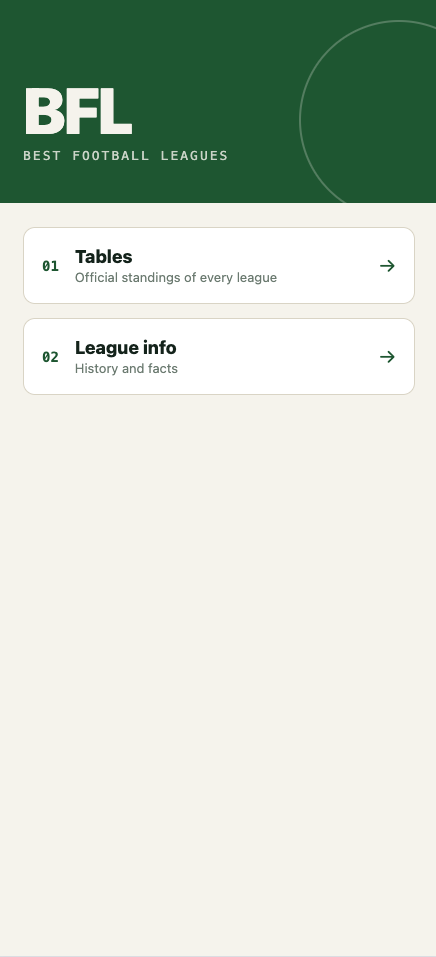
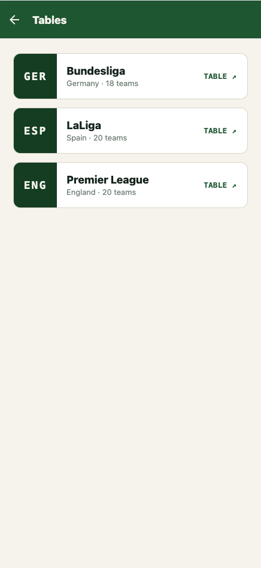
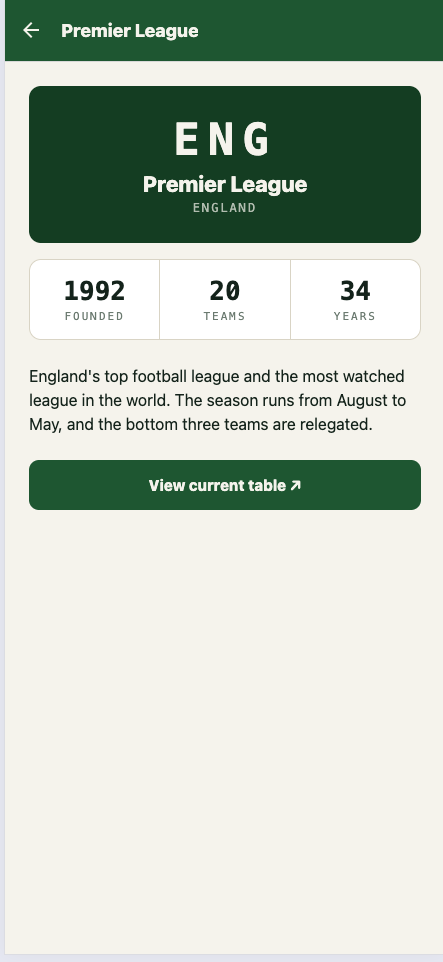

# BFL – Best Football Leagues

A small React Native app about Europe's top football leagues:
Bundesliga, LaLiga and the Premier League.

## Screenshots

  

## Features

- Home screen with a football pitch design
- Official, always up-to-date league tables (opens the league's website)
- Info page for every league: founded, number of teams, age of the league
- One reusable screen for all leagues, driven by a single data file
- Shareable URLs on the web, e.g. `/league/bundesliga`
- Runs on iOS, Android and in the browser

## Tech Stack

- React Native with Expo
- React Navigation (native stack, URL linking)

## Project Structure

```
screens/      Home, Tables, Info, League
components/   LeagueCard (used on two screens)
data/         League data
theme.js      Colors and fonts
```

## Run it locally

```bash
npm install
npx expo start --web
```

## History

First built in 2021 with Expo SDK 41.
Rebuilt in 2026 with Expo SDK 57: new navigation, reusable components,
a custom design and original texts.
